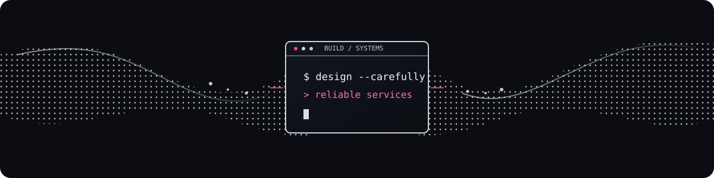

# Hi there, I'm Sweta 

### Backend Developer · Full-Stack Builder

<code>Java · Spring Boot · Node.js · React</code>

Building reliable services and useful products.

 

## 🚀 About Me

I enjoy building software from the API to the interface: designing service boundaries, connecting systems, and making features useful to people.

- 🔭 **Current project:** HealOps + MediFlow, a healthcare workflow demo with service monitoring and bounded recovery actions.
- 🌱 **Learning:** microservice architecture, API security, event-driven integrations, and containerized development.
- 🧭 **Focus:** backend engineering, distributed systems, and practical full-stack products.

 

---

## 🤝 Connect

## 🧰 Tech Stack

**Also used in project modules:** H2, PostgreSQL JDBC, Maven, JUnit, REST Assured, Spring Security, Spring Data JPA, Hibernate, Spring Cloud Gateway, Actuator/Micrometer, JWT, gRPC/Protocol Buffers, Server-Sent Events, AWS CDK, LocalStack, Cloudinary, Groq SDK, Google Generative AI, Recharts, Zustand, Framer Motion, PDF.js, and OpenWeatherMap API.

*Some tools belong to optional services or individual experiments rather than every project's default runtime.*

## 🌟 Featured Projects

| Project | What it does | Stack |
|---|---|---|
| [HealOps + MediFlow](https://github.com/Orange1008/healOPS) | Healthcare workflow demo with service health checks, incident tracking, an operations dashboard, and policy-based Docker recovery. | Java · Spring Boot · React · Docker Compose |
| [Peblo](https://github.com/Orange1008/peblo) | AI study companion for notes, quizzes, flashcards, and learning insights. [Live demo](https://peblo-44dn.vercel.app) | Next.js · TypeScript · Express · MongoDB · Groq |
| [StoryVerse](https://github.com/Orange1008/storyverse) | Visual novel platform for reading and creating stories with AI-assisted tools. [Live demo](https://storyverse-smoky.vercel.app) | React · Express · MongoDB · Generative AI |
| [Data Analytics Dashboard](https://github.com/Orange1008/data-analytics-dashboard) | Full-stack analytics app with protected data views, filters, and interactive charts. | React · Node.js · MongoDB · Recharts |
| [Admin–Employee Dashboard](https://github.com/Orange1008/Admin-Employee-Dashboard) | Role-based task dashboard with separate admin and employee workflows. | React · Vite · Tailwind CSS |

More projects

[AI Resume Analyser](https://github.com/Orange1008/ai-resume-analyser) · [Weather App](https://github.com/Orange1008/weather-app) · [Backend Practice](https://github.com/Orange1008/backend) · [Rock-Paper-Scissors](https://github.com/Orange1008/stone-paper-game)

## 📊 GitHub Stats

## 📈 Activity Graph

Contribution streak & snake

 

